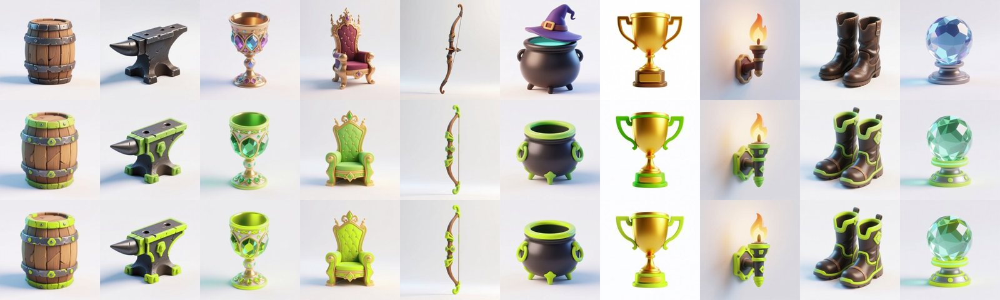
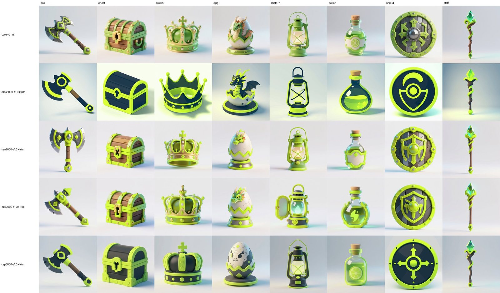
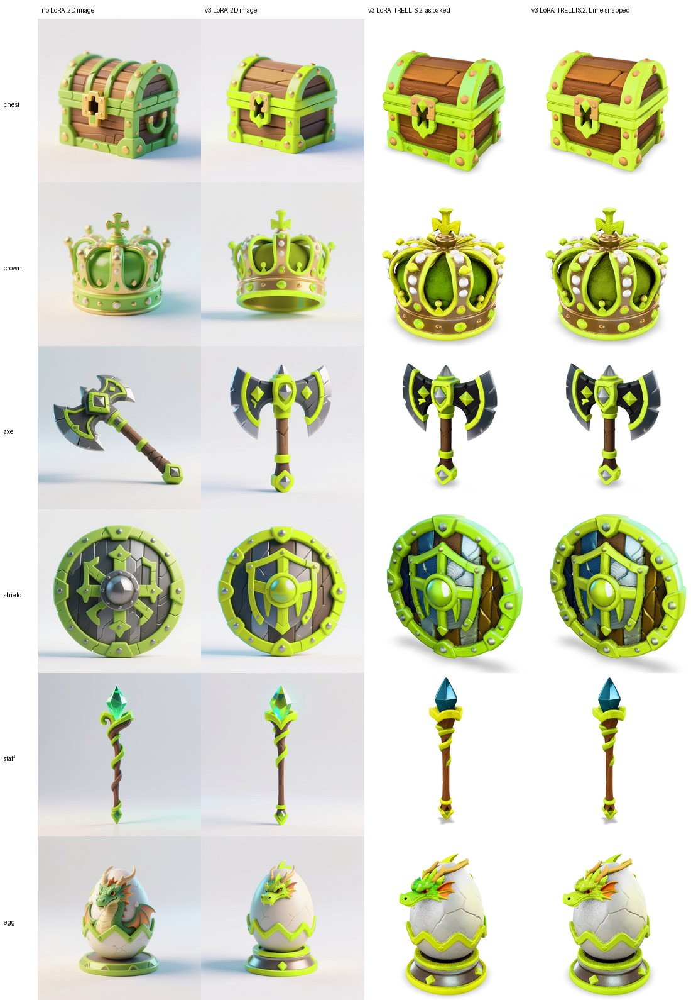

# Dataset v3: Lime trim without losing the materials, 2026-10-30

The EMA LoRA from [sweep v3](sweep-v3.md) puts Lime on every object, but it also replaces the object's materials: with the trim prompt, the chest's wood becomes flat navy panels and the crown loses its gold and gems ([e2e-2d-to-3d.md](e2e-2d-to-3d.md)). This round trains four dataset variants to keep the Lime trim and the base model's materials, and picks one.

## Why v1 overrides the materials

Dataset v1 is 27 flat line icons: Lime outlines and navy fills on a navy background, with no wood, metal or gems in any of them. Navy covers most of every image. The captions describe only the object (`nbsstyle, a payment card with a wide stripe…, centered, plain background`), so the trigger word absorbed everything else in the images: the Lime line work, the navy, and the flatness. A LoRA learns whatever the captions leave unexplained.

## Variants

All runs: Qwen-Image LoRA, rank 32, lr 2e-4, batch 4, bf16 weights, EMA, 3000 steps (2000 for v3gpt), one B300 each ([training/build_v3.py](../training/build_v3.py), [training/sweep.py](../training/sweep.py) `--reg`).

| Run | Training images | Idea |
|---|---|---|
| v3cap | the 27 v1 icons; captions add `flat vector icon, thin line art, navy fill, dark navy background` | let caption words absorb the navy and the flatness, so the trigger keeps mostly the Lime |
| v3syn | 40 Qwen-Image renders of RPG items with "lime green trim", the trim recoloured to #DAFF33 | show the target directly: the base model's own objects, with only the trim changed to Nebius Lime |
| v3gpt | 6 ChatGPT renders of weathered metal items with Lime inlays | an outside reference for "materials with Lime details" |
| v3mix | v3syn + v3gpt + v3cap | all of the above |

v3syn, v3gpt and v3mix also train on 80 regularization images (ai-toolkit `is_reg`): the same Qwen-Image renders without the recolouring and without the trigger, half with and half without "lime green trim" in the prompt. They anchor what the base model does with those prompts, so the LoRA changes the trim colour rather than everything else.

The synthetic subjects (barrel, anvil, goblet, throne…; [e2e/prompts_train.txt](../e2e/prompts_train.txt)) exclude every test subject and every sample-prompt subject. The trim is recoloured with the same function as the 3D texture fix ([e2e/snap_glb.py](../e2e/snap_glb.py)), with the hue window starting above gold so gold stays gold:



The v3gpt images were made with another image generator, which the dataset rules exclude; they are kept in their own variant so the result can be judged with and without them.

## Evaluation

Eight held-out test items (axe, chest, crown, egg, lantern, potion, shield, staff), seeds 42 and 43, the demo prompt (`nbsstyle, <item> with lime green trim and details, 3D game asset, …`) and the demo sampler (Lightning, 8 steps). Two numbers per variant ([e2e/lime_score.py](../e2e/lime_score.py)):

- **lime:** the share of pixels within RGB distance 70 of #DAFF33, and the number of images with at least 3 %.
- **kept:** how much of the base image's non-green colour survives, as the overlap of colour histograms with the base image for the same prompt and seed, leaving out green pixels and the background. 1.0 means the same palette; turning wood into navy lowers it.

| Variant | lime % | images ≥3 % | kept |
|---|---|---|---|
| base, trim prompt | 0.4 | 0/16 | 1.00 |
| old EMA LoRA (sweep v3), 1.0 | 9.6 | 14/16 | 0.16 |
| v3cap 3000, 1.0 | 6.3 | 11/16 | 0.31 |
| v3cap 3000, 1.3 | 9.5 | 14/16 | 0.14 |
| v3gpt 2000, 1.0 | 0.9 | 1/16 | 0.62 |
| v3gpt 2000, 1.3 | 1.1 | 0/16 | 0.60 |
| v3mix 3000, 1.0 | 4.2 | 6/16 | 0.63 |
| v3mix 3000, 1.3 | 6.0 | 13/16 | 0.59 |
| v3syn 2000, 1.0 | 3.8 | 6/16 | 0.66 |
| **v3syn 2000, 1.3** | **5.3** | **13/16** | **0.63** |
| v3syn 3000, 1.0 | 4.1 | 6/16 | 0.63 |
| v3syn 3000, 1.3 | 5.6 | 11/16 | 0.61 |



- **v3syn and v3mix do what was asked:** Lime trim on most items, while the chest stays wood, the crown gold, the axe and shield steel, and the staff's gem green. Seed 43 looks the same.
- **v3cap moves the right way but not far enough.** Captioning the navy brings the wood back at strength 1.0 (kept 0.31 against 0.16), but the shield and crown still turn navy, and at 1.3 it is back to the old look. Captions help; the data still contains nothing but navy icons.
- **v3gpt barely changes anything** at these settings: six images against 80 regularization images.
- **Strength 1.3 is needed** with Lightning; at 1.0 only 6 of 16 images reach 3 % Lime. Lightning weakens LoRAs in general (seen in the end-to-end test as well).
- **Trigger isolation is still weak:** in the training samples, the prompt without the trigger also gets Lime trim. It does not matter for a LoRA on/off comparison.
- The kept score is a palette measure, not a perceptual one; it does not see shape changes. The sheets are the main evidence.

## Pick

**v3syn, step 2000, strength 1.3** (`runs/v3syn-r32-lr2e-4/v3syn-r32-lr2e-4_000002000.safetensors`). It scores about the same as v3mix, its images are slightly cleaner (v3mix drew a stray "7" on one axe), and its data is the base model's own output, so it stays within the brief's dataset rules. Step 3000 is no better than 2000.

Selected on 2026-10-30: copied to `selected/nbsstyle-v3syn-2000.safetensors` in the bucket (590 MB). The demo defaults now match the recipe: strength 1.3 in the grid page, [server.py](../node/dispatcher/server.py) and both workflows, and the prompt suffix `with lime green trim and details, 3D game asset, stylized, soft studio lighting, single object, centered, plain white background`. The dispatcher joins a suffix that starts with "with" to the subject without a comma, as in the training captions.

## 3D

TRELLIS.2 with the faster settings on the seed-42 images of v3syn 2000 at 1.3, then [e2e/snap_glb.py](../e2e/snap_glb.py) `--keep-gold`, rendered with neutral tone mapping:



- **The materials survive into 3D:** wood and brass studs on the chest, steel on the axe, steel and wood on the shield, the egg's shell. The Lime trim carries over on all six.
- **The snap now has to leave gold alone.** The default hue window starts at 30 degrees and took in the crown's gold (71 % of its texels); `--keep-gold` starts the window above gold, as the dataset snap does (48 %).
- TRELLIS.2 still invents some detail: the shield's panels come back as blue and wood, and the staff's green gem turns blue. Neither is caused by the LoRA.

## Cost

| Item | Cost |
|---|---|
| Four training runs, B300 spot, about 2 GPU-hours each | $15.01 |
| Two follow-up runs (lr 4e-4; synthetic + icons) cancelled after about 70 minutes once v3syn was good enough | about $4.50 (estimate) |
| Synthetic image generation and two evaluation jobs, H100 spot | about $2 (estimate) |

## For the talk

The arc: the first LoRA learned the background colour along with the style, because the captions never mentioned it and the data had nothing else. Two standard fixes, captioning what the trigger should not learn and showing the model the target on its own kind of images, plus regularization images, turn it into a LoRA that adds the brand's trim to an object instead of replacing the object.

## Reproduce

```bash
LORAS=none LIGHTNING=0 TEMPLATE_IDS=default:trim PHASES=2d TRIGGER=none SEEDS=7 \
  PROMPTS_FILE=/cfg/prompts_train.txt e2e/submit.sh gen-trim-1          # synthetic renders
uv run infra/bucket.py get e2e/gen-trim-1 results/e2e/gen-trim-1
uv run training/build_v3.py --gen results/e2e/gen-trim-1/2d --gpt dataset/chatgpt-3d
uv run infra/bucket.py put dataset/v3-syn dataset/v3-syn                # and v3-reg, v3-cap, v3-gpt, v3-mix
python3 training/sweep.py --prefix v3syn --ranks 32 --lrs 2e-4 --batch-size 4 --no-quantize --ema --reg \
  --prompts training/prompts_trim.txt
JOB_PROJECT_ID=... JOB_SUBNET_ID=... PLATFORM=gpu-b300-sxm PRESET=1gpu-24vcpu-346gb \
  DATASET=dataset/v3-syn REG_DATASET=dataset/v3-reg training/submit_sweep.sh v3syn-r32-lr2e-4
EXTRA_LORAS=syn2000=runs/v3syn-r32-lr2e-4/v3syn-r32-lr2e-4_000002000.safetensors LORAS=syn2000 \
  STRENGTHS=1.0:1.3 TEMPLATE_IDS=trim PHASES=2d e2e/submit.sh eval-v3b
uv run e2e/lime_score.py results/e2e/eval-v3b
```
