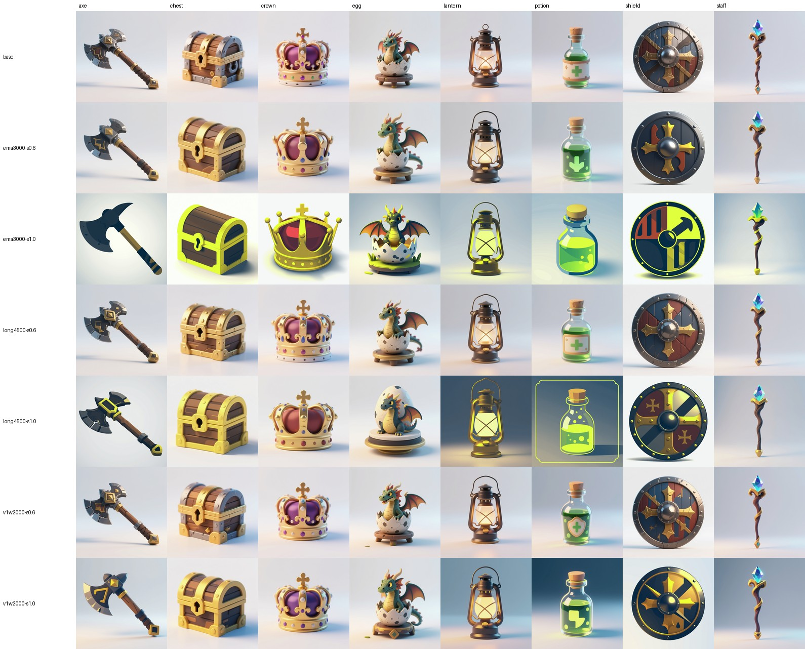
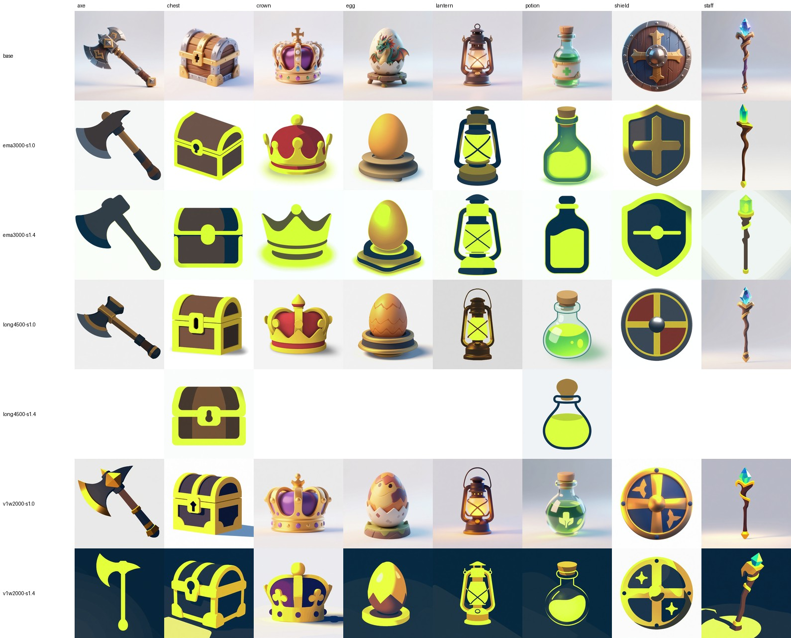
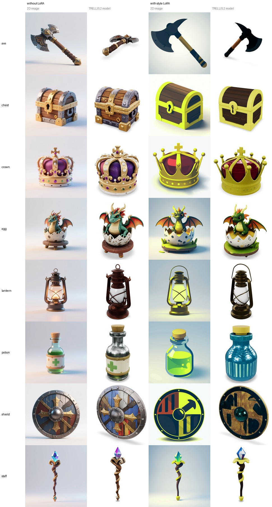
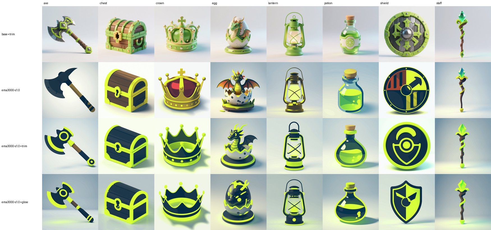
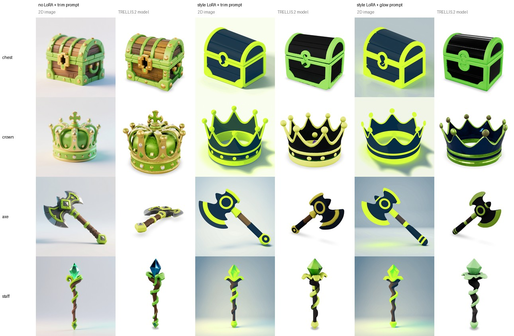
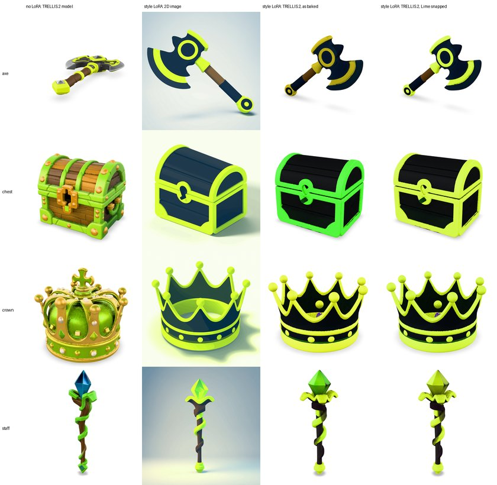
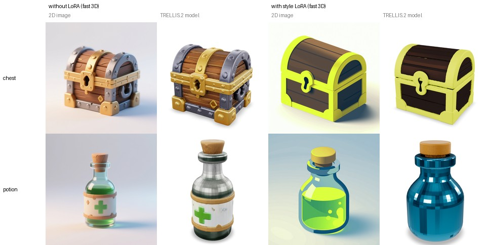

# End-to-end test: style LoRA to 2D to TRELLIS.2, 2026-10-29

First run of the whole demo chain on a GPU: Qwen-Image renders RPG items with and without the style LoRA, and TRELLIS.2 turns the images into textured GLB models. It runs ComfyUI headless inside Nebius serverless jobs (H100, spot, eu-north1), driven over its HTTP API by [e2e/driver.py](../e2e/driver.py). The workflows are the demo's own: the 2D graph matches [compare_lora.json](../workflows/compare_lora.json), and the 3D step runs [image_to_3d.json](../workflows/image_to_3d.json) unchanged.

## Setup

| Item | Value |
|---|---|
| ComfyUI | 0.43.0, commit `4845e7a`, in `pytorch/pytorch:2.14.1-cuda13.0-cudnn9-devel` |
| Models | as in [node/setup.sh](../node/setup.sh); downloaded once (about 11 minutes for 65 GB) and cached in the bucket under `cache/comfy-models/` |
| Prompt | `nbsstyle, <subject>, 3D game asset, stylized, soft studio lighting, single object, centered, plain white background`, the same text for every variant |
| Subjects | treasure chest, health potion bottle, battle axe, magic lantern, wizard staff, dragon egg, royal crown, knight's round shield; none are in dataset v1 |
| Variants | no style LoRA; `style-r32-lr2e-4` step 2000 (v1 winner); `b300bs4ema-r32-lr2e-4` step 3000 (EMA); `long1-r32-lr2e-4` step 4500; each LoRA at strength 1.0 and 0.6 |
| 2D sampling | Qwen-Image bf16 with the Lightning 8-step LoRA (the demo setting), seeds 42 and 43; a second run without Lightning (30 steps, CFG 4) at strengths 1.0 and 1.4 |
| 3D | seed-42 images; all variants for the chest, no-LoRA and EMA at 1.0 for the other seven |

## 2D: only the EMA checkpoint carries the style into 3D-looking objects



With Lightning, the EMA checkpoint at strength 1.0 is the only variant that gives what the demo needs: shaded, volumetric game objects in Lime and Deep Blue (chest, crown, lantern, potion, shield). The v1 winner and the long run add only accents at 1.0, and every LoRA at 0.6 is close to the base model. The EMA checkpoint transfers more strongly to new prompts than the others; why is not established (it is also the only batch-4 run among the three).



Without Lightning, every LoRA applies the style much more strongly, but the objects turn into flat vector icons, like the training illustrations. Flat images make thin 3D models (see the axe below), so for this demo the Lightning setting is not only faster but also better. Lightning appears to weaken the style LoRA; that is an inference from these two runs, not a controlled test.

| | Lightning, 8 steps | No Lightning, 30 steps |
|---|---|---|
| Seconds per 1024 px image, H100 | about 2 | about 10.4 |

## 3D: the style survives on solid objects, not on glass or flat ones



The 3D stills are from the GLBs rendered at one fixed angle in a browser with [model-viewer](https://modelviewer.dev/) ([e2e/capture_server.py](../e2e/capture_server.py)).

- **Works:** chest, crown, staff, egg. The Lime parts and the overall look carry over, and the models are clean and textured.
- **Lime turns yellow in 3D.** Measured in the baked texture of the EMA chest: Lime pixels average (213, 206, 2), against (210, 226, 56) in the 2D image and (218, 255, 51) for Nebius Lime. TRELLIS.2's texture stage shifts the hue towards yellow, and the viewer's lighting dulls it further. Snapping the base-colour texture back to the palette after baking (as `training/snap_palette.py` does for images) would likely fix it; not tried.
- **Glass and glow are lost.** The lantern's Lime glass becomes white, and the potion's Lime liquid becomes an opaque blue bottle.
- **Flat images give thin models.** The styled axe is drawn nearly in profile, so its model is a thin cut-out. The styled shield's flat emblem comes back as a dark, worn texture.

For the demo, prompt for solid objects (chests, crowns, eggs, staffs, helmets) and avoid glass, liquids and flat items.

## Lime trim: ask for it in the prompt, with the LoRA (run `e2e-4-trim`)

What matters for the look is the Lime trim and detail on the object, so `e2e/lime_score.py` measures the share of pixels near #DAFF33 (within an RGB distance of 70). It ignores where the Lime is, so read it next to the sheets. The run compares three prompt wordings ([e2e/templates.txt](../e2e/templates.txt)) with and without the EMA LoRA, eight items, two seeds:

| Variant | Images with ≥3% Lime | Mean Lime % |
|---|---|---|
| no LoRA, any wording | 0 of 16 | 0.0 to 0.4 |
| EMA 1.0, default prompt | 11 of 16 | 6.8 |
| EMA 1.0, "with lime green trim and details" | 14 of 16 | 9.6 |
| EMA 1.0, "with glowing lime green edges and accents" | 15 of 16 | 9.5 |
| EMA 0.8, trim prompt | 12 of 16 | 6.8 |



- **The prompt alone does not do it.** Without the LoRA, "lime green trim" gives generic apple-green trim (0% Nebius Lime). The LoRA is what brings the exact colour and the outlined look; this is the control for the talk.
- **With the LoRA, the trim prompt makes the Lime reliable,** including the axe and staff that had none with the default prompt. The cost is a flatter, more cel-shaded look.



- **The trim survives into 3D** on all four objects, and the axe now has volume instead of being a cut-out.
- **The glow wording drifts to green in 3D** (the chest); the trim wording keeps closer to Lime.
- 3D in this run used the faster settings, in the same job as the 2D images but after asking ComfyUI to unload Qwen-Image (`/free`): 12 to 104 s per object.

### Snapping the baked texture back to Lime

The four 2D images have the same Lime (hue 71 to 81 degrees; Nebius Lime is 72), but the baked textures drift differently per object, because TRELLIS.2 generates the texture rather than projecting the image. Mean colour of the bright yellow-green texels:

| Object | 2D image | Baked texture | After `e2e/snap_glb.py` |
|---|---|---|---|
| axe | (210, 245, 55) | (160, 146, 26), mustard | (206, 241, 49) |
| chest | (198, 240, 53) | (60, 242, 22), pure green | (213, 249, 50) |
| crown | (184, 229, 48) | (234, 250, 50) | (215, 250, 51) |
| staff | (178, 242, 63) | (168, 225, 24) | (193, 225, 45) |

The trim texels are non-metallic and rough on all four models, so the drift is in the base colour, not the material. [e2e/snap_glb.py](../e2e/snap_glb.py) recolours bright, saturated yellow-to-green texels in the base-colour texture to Lime, scaled by brightness so the baked shading stays, and writes `<name>-snap.glb`. It takes under a second per model on a laptop and leaves geometry and the other textures alone.



- **It works on all four:** the chest is no longer green and the axe no longer mustard.
- **It recolours any yellow-green,** so the staff's green gem becomes Lime as well. Run it only on style-LoRA models; on the no-LoRA models it would fake the style.
- **The viewer matters too.** model-viewer's default tone mapping washed bright Lime out to pale yellow in the earlier stills; `tone-mapping="neutral"` keeps it, and [capture.html](../e2e/capture.html) and [view.py](../e2e/view.py) now set it. The stills above this subsection were rendered before that change. With neutral tone mapping, the no-LoRA axe's trim also reads close to Lime; what the LoRA adds there is the Deep Blue body and the outlined shapes.
- Deep Blue renders close to black in 3D. Not addressed.

## 3D speed: about 30 to 120 s per object, if TRELLIS.2 has the GPU to itself

| Run | Seconds per object | GLB size |
|---|---|---|
| Same job as the 2D images (Qwen-Image loaded) | 426 to 608 | 16 to 17 MB |
| 3D-only job, first object (includes model loading) | 94 to 324 | 16 to 19 MB |
| 3D-only job, later objects, workflow as shipped | 30 to 118 | 13 to 18 MB |
| 3D-only job, faster settings | 20 to 32 warm (150 for the first) | 3.7 to 5.2 MB |

The first row is slow most likely because Qwen-Image (about 50 GB with its text encoder) stayed in GPU memory and TRELLIS.2 ran in what was left. The driver now calls ComfyUI's `/free` before the 3D phase, and in `e2e-4-trim` the 3D step in the same job took 12 to 104 s, which supports that explanation. On the demo node, either keep some GPUs for 3D only or unload the image model before a 3D job.

The faster settings ([image_to_3d_fast.json](../workflows/image_to_3d_fast.json)) upsample to 1024 instead of 1536, decimate to 60 000 faces instead of 200 000, and bake 1024 px textures instead of 2048. At the size of a slide or a game prop they look about the same:



Stage times for one fast-settings object: structure under 1 s, shape 4 s, upsample 44 s, texture 23 s on a cold start; the warm runs took 20 to 32 s in total. The upsample stage is the biggest single cost.

## Cost

About $7 at $2.00 per H100-hour (spot): $4.27 for the seven jobs that finished, and an estimated $2.50 for the four jobs cancelled during debugging, including the first combined run. The Lime-trim run (`e2e-4-trim`, 144 images and 12 models) cost $0.97.

## Recommendations

- **Superseded by [dataset v3](dataset-v3.md):** the EMA LoRA replaces the objects' materials with navy. The v3 pick, `v3syn-r32-lr2e-4` step 2000 at strength 1.3, keeps the materials and adds the Lime trim.
- ~~Demo LoRA: `b300bs4ema-r32-lr2e-4` (final, step 3000) at strength 1.0, with Lightning 8 steps.~~
- **Demo prompt: add "with lime green trim and details".** Lime trim in 14 of 16 images instead of 11, and it survives into 3D.
- **Use the faster 3D settings for the live part:** 20 to 32 s per object and GLBs of about 4 MB, against 30 to 120 s and 13 to 19 MB.
- **Give 3D its own GPUs** (or unload Qwen-Image first); with both models on one GPU an object took 7 to 10 minutes.
- **Pick demo prompts for solid objects**; with the trim prompt the axe works, but glass and liquids (potion, lantern) still lose their Lime in 3D.
- **Run `e2e/snap_glb.py` on every style-LoRA model** after TRELLIS.2, so Lime stays Lime in 3D, and view the models with neutral tone mapping. Use `--keep-gold` for v3 models, which keep their gold.
- **Still not covered:** RTX PRO 6000 (`sm_120`), the eight-instance node, the grid page, and import into Godot and Blender.

## Reproduce

```bash
e2e/submit.sh e2e-2                                     # 2D for every variant, then 3D for chest, potion, axe, lantern
PHASES=3d PROMPTS_3D=crown:egg VARIANTS_3D=base:ema3000-s1.0 E2E_DIR=e2e-2 e2e/submit.sh e2e-2-3d-more
uv run infra/bucket.py get e2e/e2e-2 results/e2e/e2e-2
uv run e2e/sheet.py results/e2e/e2e-2 --seed 42 --out results/e2e/e2e-2-s42.jpg
python3 e2e/view.py results/e2e/e2e-2                   # index.html: each image next to its rotating model
python3 e2e/capture_server.py results/e2e/e2e-2 8766   # then open http://127.0.0.1:8766/capture.html
uv run e2e/before_after.py results/e2e/e2e-2 --out results/e2e/e2e-2-before-after.jpg
uv run e2e/snap_glb.py results/e2e/e2e-4-trim/3d/ema3000-s1.0+trim__*.glb   # then capture.html?only=-snap
```
