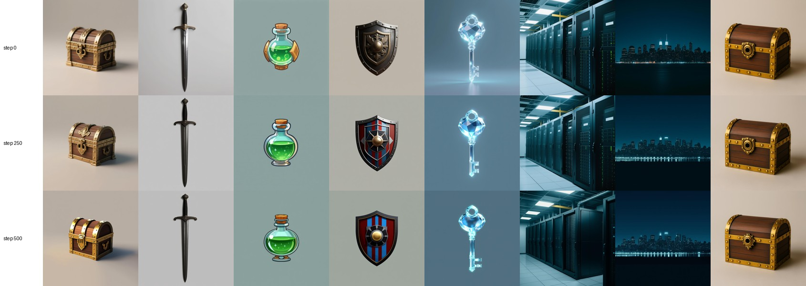

# Pilot run, 2026-10-28

One short training run to test the whole pipeline before the real illustrations are chosen. It used the 12 stand-in images from `training/make_standin_dataset.py`, not Nebius art, so the result says nothing about the final style.

## Setup

- Job: `pilot-r16-lr1e-4`, one preemptible H100 80 GB in eu-north1 at the current spot price (`--preemptible --follows-spot-price`). It was not preempted.
- Image: `ostris/aitoolkit:0.13.39`, unchanged, with `training/run_job.sh` and the config injected.
- Config: `training/base.yaml` with rank 16, learning rate 1e-4, 500 steps, samples and checkpoints every 250 steps.
- Data in and out through the bucket mounted at `/data`.

## Result

The pipeline worked end to end. The job exited with code 0, and the bucket holds both checkpoints, the final LoRA, 24 sample images (8 prompts × steps 0, 250 and 500), the resolved config and `timing.json`.

## Measured numbers

| Measure | Value |
|---|---|
| Total job time (script start to end) | 1856 s (31 min) |
| Model download and load (≈57 GB from Hugging Face, qfloat8 quantization) | about 6 min |
| Latent and text-embedding caching, 12 images × 3 resolutions | about 1 min |
| Training speed | 1.5 to 1.7 s per step (batch 1, mixed 512/768/1024) |
| Sample rendering, 1024 × 1024, 25 steps | about 23.6 s per image |
| LoRA file size, rank 16, fp16 | 295 MB (295,144,504 bytes) |
| GPU memory | fits in 80 GB with qfloat8; peak not recorded |

The spot price paid was not recorded, so the run's cost is not known yet. `training/collect_metrics.py` should read it from billing once it exists.

## Projection for a full sweep run (estimate)

At 3000 steps with samples every 500 steps: about 6 min loading, 80 min training, and 22 min sampling (7 rounds × 8 prompts × 23.6 s). That is about 1 h 50 min per run. The eight runs execute in parallel, so the sweep takes about the same wall-clock time as one run.

## What the samples show

Rows are steps 0, 250 and 500; columns follow `training/prompts.txt`. After 500 steps at 1e-4, the outputs have barely moved toward the stand-in style (navy background, teal outlines, lime fill). The shield and potion shift slightly. That is expected for so few steps, and it supports the sweep's range: up to 3000 steps and learning rates up to 4e-4. The control prompt without the trigger word (last column) is unchanged, as intended.

## Changes made because of the pilot

- The bucket mount is mountpoint-s3, which cannot overwrite files. `run_job.sh` now copies each finished file once, and skips files modified in the last two minutes.
- The S3 secret needs the keys `S3_ACCESS_KEY_ID` and `S3_SECRET_ACCESS_KEY`, and the CLI needs an endpoint-only AWS profile locally. Both are documented in [infra/README.md](../infra/README.md).
- `training/contact_sheet.py` builds the sheet above from a run's samples.
