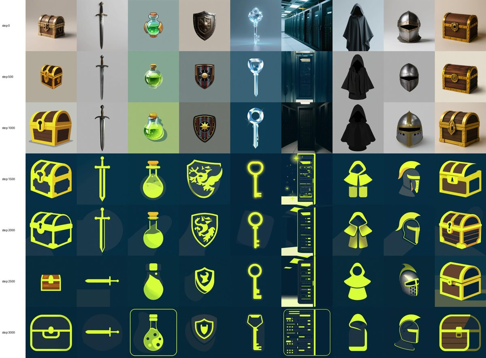
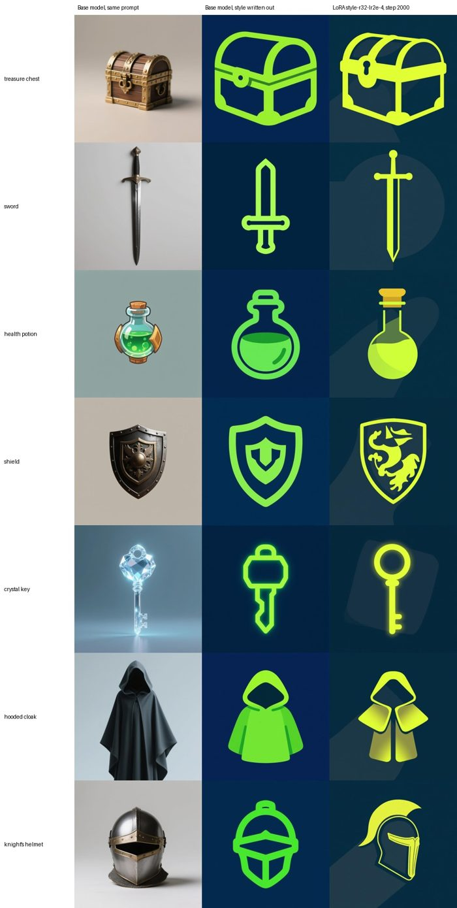

# Sweep v1, 2026-10-28

Eight training runs on dataset v1: 27 Nebius service illustrations recoloured to Lime lines on Deep Blue, with hand-written captions and the trigger word `nbsstyle` (see [workflow.md](workflow.md)). Settings: rank {16, 32} × learning rate {5e-5, 1e-4, 2e-4, 4e-4}, 3000 steps, a checkpoint and nine sample images every 500 steps.

## Measured

| Measure | Value |
|---|---|
| Hardware | one H100 80 GB per run, preemptible at the spot price, eu-north1 |
| Preemptions | none |
| Wall-clock per run | 6662 to 6890 s (1 h 51 min to 1 h 55 min) |
| Wall-clock for the sweep | about 1 h 55 min (runs in parallel) |
| GPU-hours | 15.1 of training (timing.json); 15.6 billed window from job creation to finish |
| Cost at spot | about $29: 15.6 GPU-hours at a spot price of $1.70 to $2.00 per GPU-hour during the sweep (`training/spot_cost.py`, from the public spot-price series; the billing report is the final figure) |
| LoRA file size | 295 MB at rank 16, 590 MB at rank 32 |
| Training loss | low from the start (about 0.008) and falling slowly (about 0.005); flat graphics are easy to denoise, so loss says little here |

At the $4.50 on-demand list price the same 15.6 GPU-hours would be about $70, so spot cost about 40% of on-demand. The spot price moves through the day: during the sweep (20:00 to 22:00 UTC) it was $1.70 to $2.00; the next morning it was $0.79.

## What the samples show

- **Learning rate decides whether the style appears at all.** At 5e-5 the outputs stay realistic for all 3000 steps. At 1e-4 the style only starts to show at 2500 to 3000 steps. At 2e-4 and 4e-4 it appears.
- **Rank 32 at 2e-4 is the best run.** The style switches on between steps 1000 and 1500, then stays stable to 3000. Rank 16 at 2e-4 barely moves.
- **Rank 32 at 4e-4 peaks at step 2000 and then collapses.** By step 3000 the objects fade into navy shapes. Rank 16 at 4e-4 is unstable from checkpoint to checkpoint.
- **The control prompt is styled too.** The prompt without the trigger word also becomes lime on navy once the style appears, so the trigger word does not switch the style off. LoRA strength is the switch.

Rows are steps 0 to 3000; columns follow `training/prompts.txt`: chest, sword, potion, shield, key, server rack, cloak, helmet, and the control prompt without the trigger.

## Candidate checkpoints

- **`style-r32-lr2e-4` step 2000:** strong, recognisable game items: solid Lime objects with Deep Blue detail, and the translucent offset background shapes of the source illustrations. The recommended pick for the live grid.
- **`style-r32-lr2e-4` step 3000:** closer to the training images (outlines with navy fill panels, framed panels), but some objects lose their shape (the cloak).

## Against the prompt-only baseline

The base model with the style written out in the prompt already draws lime outline icons on blue. The LoRA at step 2000 differs in three ways: the exact yellow-leaning Nebius lime instead of grass green; one consistent background instead of navy, royal blue and near-black; and the offset background shapes and solid-fill shape language of the source illustrations, which the written prompt never produces.

## Next

- Done in [sweep v2](sweep-v2.md): the generated items did not help, and an exact repeat of `style-r32-lr2e-4` did not reproduce its result, so the winner was an early arrival in a noisy process.
- Load the step-2000 checkpoint in ComfyUI on the node and check it at strengths below 1.0, including for the 3D step.
