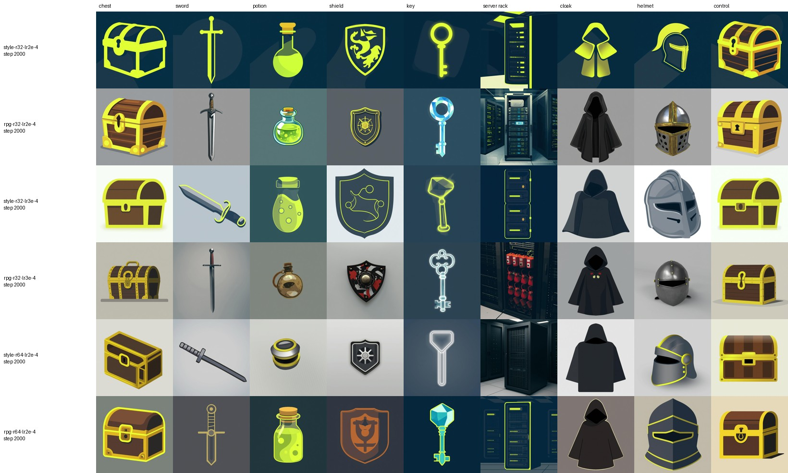
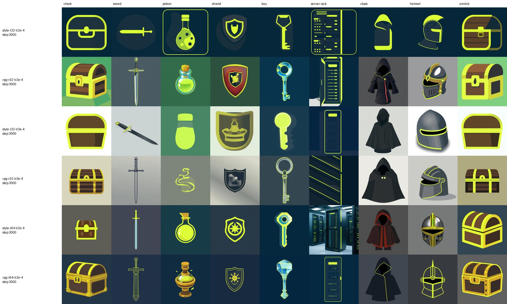
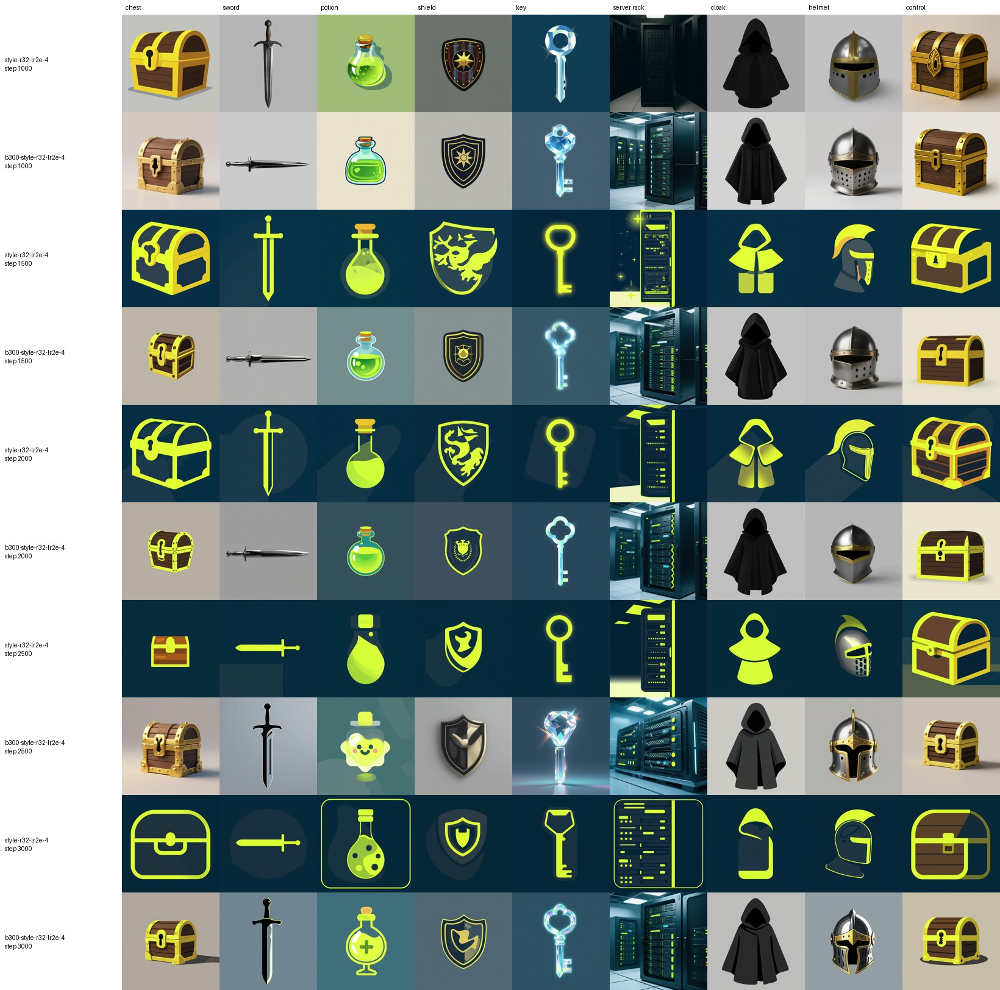

# Sweep v2, 2026-10-29

Five runs to test two things from [sweep v1](sweep-v1.md): whether 17 generated medieval items help the style transfer to game objects, and whether nearby settings beat the v1 winner (`style-r32-lr2e-4`). Plus one repeat of the v1 winner on a B300, for speed and reproducibility.

| Run | Dataset | Rank | Learning rate | Question |
|---|---|---|---|---|
| `rpg-r32-lr2e-4` | v2 | 32 | 2e-4 | generated items, same settings as the v1 winner |
| `rpg-r32-lr3e-4` | v2 | 32 | 3e-4 | generated items, slightly higher learning rate |
| `style-r32-lr3e-4` | v1 | 32 | 3e-4 | control: learning rate 3e-4 without generated items |
| `style-r64-lr2e-4` | v1 | 64 | 2e-4 | higher rank |
| `rpg-r64-lr2e-4` | v2 | 64 | 2e-4 | higher rank with generated items |
| `b300-style-r32-lr2e-4` | v1 | 32 | 2e-4 | exact repeat of the v1 winner on a B300 in us-north1 |

Dataset v2 is v1 (27 recoloured service illustrations) plus 17 ChatGPT images snapped to the three dataset colours by `training/snap_palette.py`: anvil, battle axe, campfire, candle, castle tower, coin pouch, crown, goblet, horseshoe, lantern, longbow, mace, ring, spear, torch, war hammer, wooden barrel. None of the sample-prompt subjects are in it. Everything else (3000 steps, samples every 500, prompts, sampling seed) is unchanged from v1.

## Measured

| Measure | Value |
|---|---|
| Hardware | one H100 80 GB per run, preemptible, eu-north1 |
| Preemptions | none |
| Wall-clock per run | 6647 to 6926 s (1 h 51 min to 1 h 55 min), rank 64 no slower than rank 32 |
| GPU-hours | 9.7 (billed window, creation to finish) |
| Cost at spot | about $8.20 at $0.83 to $0.87 per GPU-hour (`training/spot_cost.py`) |
| LoRA file size | 1.18 GB at rank 64 |

The v1 sweep the evening before paid $1.70 to $2.00 per GPU-hour, about $1.89 on average; this sweep paid about $0.84, 55% less per GPU-hour, only because it ran in the morning (UTC).

## What the samples show

**No new run reached the v1 winner's style by step 3000, including the two v1 controls.** At step 2000 the v1 winner draws solid Lime objects on Deep Blue with the offset background shapes; every other run still draws ordinary game icons with some Lime accents on grey or slate backgrounds. By step 3000 all of them are moving towards the style (Lime outlines, darker backgrounds), but none is there.

- **The generated items did not help.** At rank 32 and 2e-4, the v2 run trails the v1 run by a wide margin. But the v1 control at 3e-4 also trails, so the gap cannot be put down to the dataset alone.
- **Learning rate is not monotonic.** On v1 at rank 32: 2e-4 strong at step 1500, 3e-4 weak at 3000, 4e-4 strong at 2000 and collapsed by 3000. The simplest explanation is run-to-run variance: training noise is not seeded (the `seed: 42` in `base.yaml` only fixes the sample images), so two runs with the same settings take different paths.
- **Rank 64 is not better than rank 32.** Both rank-64 runs are slower to pick up the style than the rank-32 winner, and the files are twice as large.

Working conclusion: the style is learnable from the 27 illustrations, but how soon a given run gets there varies a lot. The B300 repeat below confirms it: the v1 winner was an early arrival, not the result of better settings.

## B300 repeat

`b300-style-r32-lr2e-4` repeats the v1 winner exactly (same config, dataset v1, same image) on one B300 in us-north1, reading and writing the eu-north1 bucket.

| | H100, eu-north1 (v1 sweep) | B300, us-north1 |
|---|---|---|
| Wall-clock (timing.json, includes model download and samples) | 6890 s | 5644 s (18% less; 1.22x as fast) |
| Training step, early in the run | 1.5 to 1.6 s | 1.28 s |
| Sample image (Qwen-Image, 25 steps) | about 24 s | 18 to 24 s |
| Spot price at the time | $1.70 to $2.00 (evening); $0.83 to $0.87 (morning) | $2.00, unchanged since the previous afternoon |
| Cost of the run | $3.74 (evening) | $3.36 |

The B300 is only modestly faster on this job. Batch size 1 on a qfloat8-quantized model does not keep the GPU busy, so most of the B300's extra compute goes unused (an inference: GPU utilisation was not measured). A larger batch, or bf16 weights instead of qfloat8 (the B300 has 275 GB), would be the next things to try if speed matters. At the morning H100 price the H100 run costs about half as much.

**The repeat did not reproduce the result.** The B300 run follows the same slow path as the other new runs: ordinary game icons with Lime accents at steps 1500 to 3000, never the solid Lime-on-Deep-Blue look the original reached at step 1500. Different GPU numerics could contribute, but the two H100 controls on v1 behaved the same way, so unseeded run-to-run variance is the more likely explanation.

## Recommendations

- Keep `style-r32-lr2e-4` step 2000 as the LoRA for the demo. The checkpoint exists and works; it just cannot be recreated on demand with the current recipe.
- Drop dataset v2. It adds no measurable benefit, and generated images conflict with the dataset rules.
- If another sweep is needed: run the same settings two or three times rather than more grid points, and train to 4000 to 5000 steps so slower runs arrive.
- For the talk, the variance is a point in favour of the parallel sweep: with eight runs at once, one of them arrived early, and the grid of contact sheets is how it was found.
- Run sweeps when the spot price is low (it was $0.79 to $0.87 on the morning of 2026-10-29 and $1.70 to $2.00 the evening before); `nebius billing v1alpha1 spot-price list` shows the current price.

Next: [sweep v3](sweep-v3.md) (batch 4 on B300, longer batch-1 runs).
