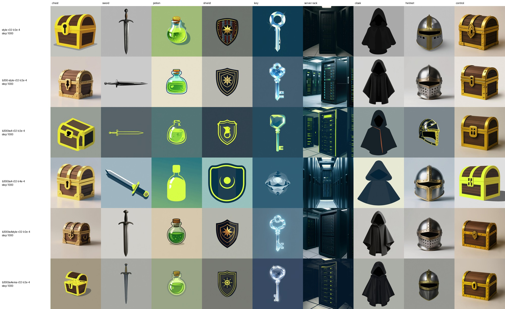
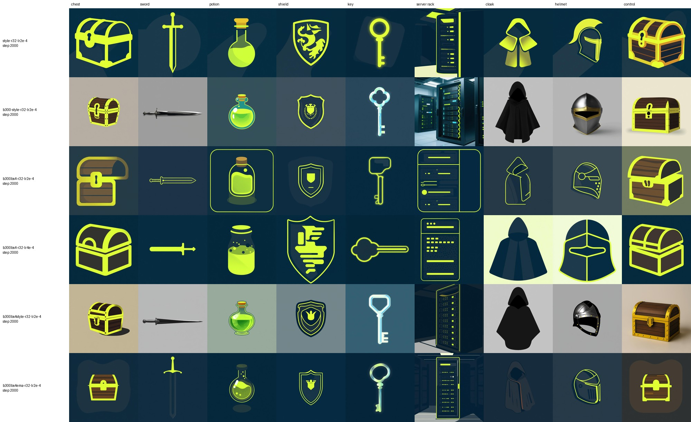
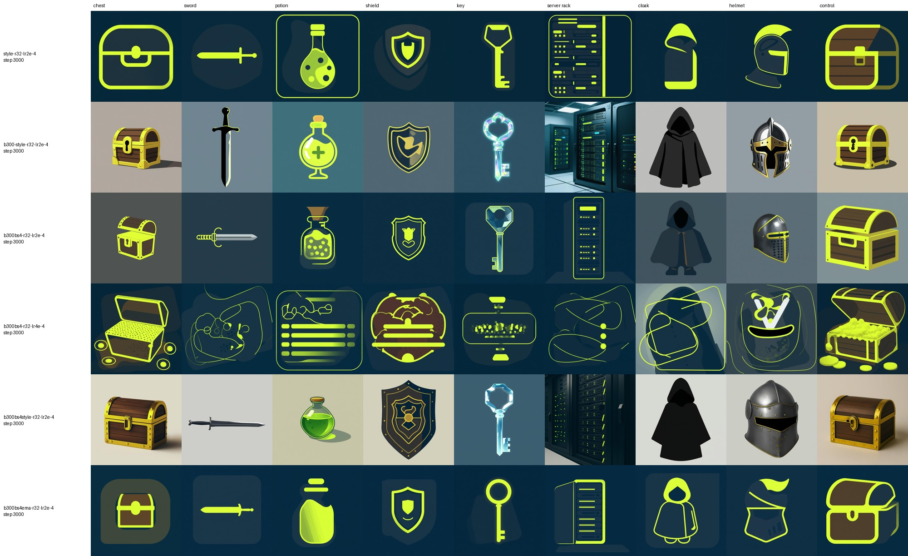
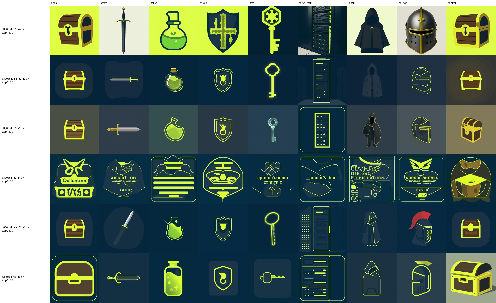
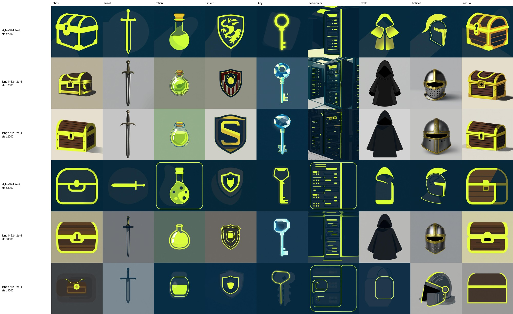
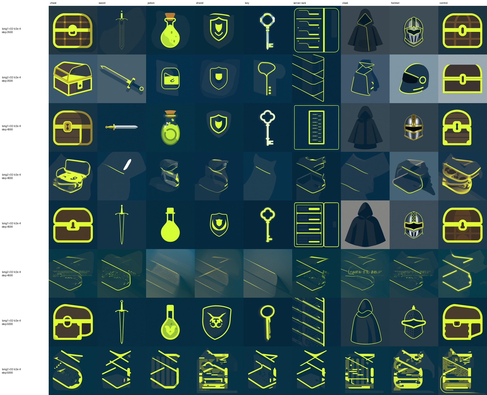

# Sweep v3, 2026-10-29

Six runs on dataset v1 at rank 32, following [sweep v2](sweep-v2.md). Two questions: does a larger batch with unquantized weights make the B300 worth using, and do the slow runs from v2 arrive if they train longer?

| Run | GPU | Batch | Weights | Steps | Other change |
|---|---|---|---|---|---|
| `b300bs4-r32-lr2e-4` | B300, us-north1 | 4 | bf16 | 3000 | none |
| `b300bs4-r32-lr4e-4` | B300, us-north1 | 4 | bf16 | 3000 | learning rate 4e-4 |
| `b300bs4style-r32-lr2e-4` | B300, us-north1 | 4 | bf16 | 3000 | `content_or_style: style` (timesteps weighted towards low noise) |
| `b300bs4ema-r32-lr2e-4` | B300, us-north1 | 4 | bf16 | 3000 | EMA of the LoRA weights, decay 0.99 |
| `long1-r32-lr2e-4` | H100, eu-north1 | 1 | qfloat8 | 5000 | none (v1 winner's recipe) |
| `long2-r32-lr2e-4` | H100, eu-north1 | 1 | qfloat8 | 5000 | none (second copy) |

The B300 runs change batch size and weight format together, so their effect cannot be separated in this sweep. `training/sweep.py` gained `--batch-size`, `--no-quantize`, `--content-or-style` and `--ema` for these runs.

## B300 at batch 4

### Speed and cost

| Measure | H100, batch 1, qfloat8 (v1, v2) | B300, batch 1, qfloat8 (v2 repeat) | B300, batch 4, bf16 (v3) |
|---|---|---|---|
| Training step | 1.5 to 1.6 s | 1.28 s | about 1.78 s |
| Time per training image | 1.5 to 1.6 s | 1.28 s | about 0.44 s |
| Sample image (Qwen-Image, 25 steps, 1024 px) | about 24 s | 18 to 24 s | 5.5 s |
| Wall-clock per run (timing.json) | 6647 to 6926 s | 5644 s | 6716 to 6767 s |
| Cost per run at spot | $3.74 (evening), about $1.65 (morning) | $3.36 | $3.96 |
| Out-of-memory errors | none | none | none |

The per-step time for batch 4 comes from the job log: 3000 steps in 1 h 34 min, minus about 5 minutes of sample generation. At 0.44 s per training image the B300 at batch 4 processes images about 3.5 times as fast as the H100 at batch 1, and 2.9 times as fast as the same B300 at batch 1. Each batch-4 run trained on 12 000 images in about the time a batch-1 run took for 3000.

Sample generation fell from 18 to 24 s per image to 5.5 s. The likely cause is bf16 weights instead of qfloat8: the quantized model dequantizes on every forward pass. This is an inference from the two configurations, not a separate measurement, but it matters for the live demo. If the demo GPUs have memory for bf16 Qwen-Image, generation should run without quantization.

The four runs cost $15.84 in total: 7.9 GPU-hours at $2.00, the same B300 spot price as the day before (`training/spot_cost.py --project <us-north1 project> --region us-north1`).

### What the samples show

Rows are the v1 winner (H100), the v2 repeat on B300 at batch 1, and the four batch-4 runs.

- **Three of the four batch-4 runs reached the style.** In sweep v2, most batch-1 runs on the same data had not reached it by step 3000, including an exact repeat of the winner.
- **EMA was the most stable.** Styled from step 1500 and improving steadily to step 3000, where it matches the v1 winner. It did not oscillate or collapse.
- **Learning rate 4e-4 was fastest and then broke.** Partly styled at 1000, strong at 2000, garbled text and abstract shapes from 2500 onward. Usable only if the checkpoint is picked carefully.
- **Plain batch 4 at 2e-4 oscillated.** Outline style at 1500 and 2500, partly back to realistic objects at 3000.
- **`content_or_style: style` was the worst run.** Almost no style by step 3000. A likely explanation is that the palette and layout are set at the high-noise timesteps, which this mode samples less often.
- **The style leaks into the control prompt** (no trigger word) in every run that learned it, as it did for the v1 winner. The trigger word is not isolating the style.

A batch-4 step uses four images, so step 2000 at batch 4 corresponds to 8000 images, against 3000 for a complete batch-1 run. Measured in wall-clock rather than steps, batch 4 reached the style in about an hour of training, which is less than a full batch-1 run on the H100.

## Longer batch-1 runs on H100

Two copies of the v1 winner's recipe (batch 1, qfloat8, learning rate 2e-4), trained to 5000 steps to see whether the slow runs from v2 arrive.

| Measure | Value |
|---|---|
| Wall-clock per run (timing.json) | 10 976 s and 10 826 s (about 3 h) |
| Training step | about 1.7 s (job log) |
| GPU-hours | 6.2 (billed window, creation to finish) |
| Cost at spot | $9.29 for both, about $1.50 per GPU-hour (`training/spot_cost.py --prefix long`) |

- **Both runs arrived, later than the original.** At step 2000 both still draw ordinary game icons with Lime accents, like the v2 runs. `long2` has the style at step 3000, `long1` partly at 3000 and fully at 3500. The v2 runs stopped at 3000, just before this point.
- **`long1` stayed good to 5000.** Steps 4500 and 5000 are clean, solid Lime on Deep Blue, among the best samples so far.
- **`long2` collapsed from step 4000.** The offset background shapes take over and the objects disappear into diagonal stripes by 4500. This is the same failure as `b300bs4-r32-lr4e-4` at 2500, reached later.

So the batch-1 recipe does learn the style, but when it arrives and how long it lasts both vary by more than 1000 steps between identical runs. Saving a checkpoint every 500 steps and choosing from a contact sheet is necessary, not optional.

## Recommendations

- **Recipe for any further training: B300, batch 4, bf16, learning rate 2e-4, EMA, 3000 steps.** About $4 and under two hours per run. It reached the style by step 1500 and did not degrade. One run is not proof of reliability; two or three copies in parallel cost about $8 to $12 and would test it.
- **On H100 at batch 1: train to 4000 steps and pick the checkpoint from contact sheets.** The style arrives between 1500 and 3500 and may collapse after 4000.
- **Demo LoRA candidates:** `style-r32-lr2e-4` step 2000 (current choice), `b300bs4ema-r32-lr2e-4` step 3000, `long1-r32-lr2e-4` step 4500 or 5000. All three show the style across the eight test objects. The choice should come from generating the demo prompts with each.
- **Drop `content_or_style: style`** for this dataset.
- **Trigger isolation is weak.** The style appears without the trigger word in every run that learned it. This does not matter for a with/without-LoRA comparison, but it does if the demo loads the LoRA and expects un-triggered prompts to stay unstyled. Regularization images (ai-toolkit datasets with `is_reg: true`) are the usual fix; not tested.
- **Use bf16 weights for generation in the demo** if the GPUs have the memory: 5.5 s per sample image against 18 to 24 s with qfloat8 on the B300 (inference from the training samples, to be measured on the demo node).
- **For the talk:** the collapses (`long2` at 4000, the 4e-4 run at 2500) and the different arrival times are a concrete argument for running a sweep in parallel and looking at a grid, rather than trusting one long run.

Total cost of sweep v3: about $25 ($15.84 for the four B300 runs, $9.29 for the two H100 runs).

Next: [end-to-end test](e2e-2d-to-3d.md) (2D with each candidate LoRA, then TRELLIS.2).

Next: [dataset v3](dataset-v3.md), which keeps the objects' materials.
